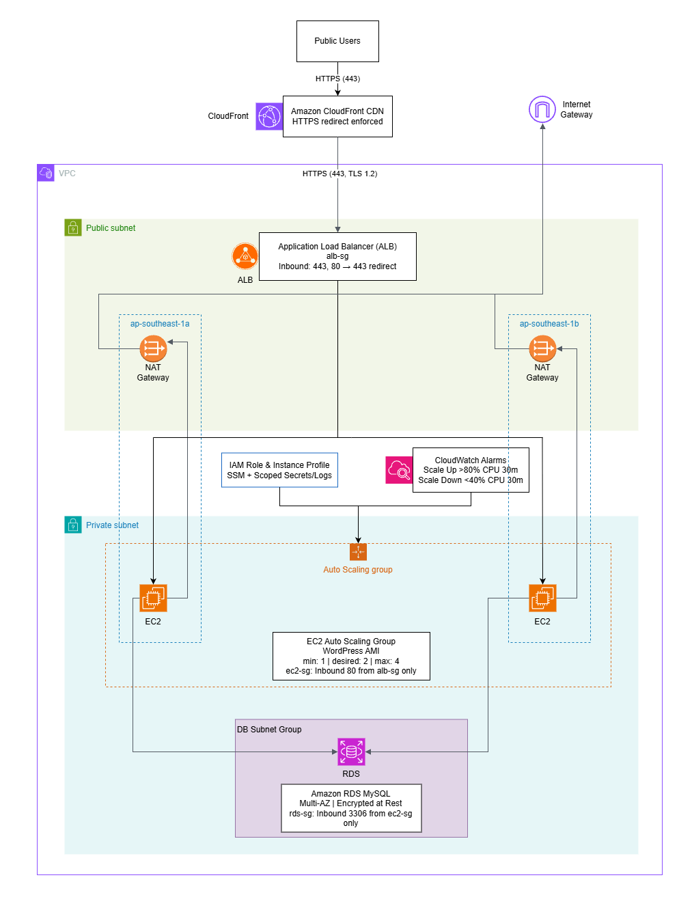

# PT Yakin Bisa Lolos – Secure 3-Tier WordPress on AWS (Terraform)

Modular Terraform for a highly available, secure WordPress site on AWS (`ap-southeast-1`):
**CloudFront → ALB → EC2 Auto Scaling Group → RDS MySQL**, inside a 3-tier VPC.

> Validated **offline at $0 cost** with `terraform plan` (mock credentials, no live `data` sources).  
> Result: `Plan: 72 to add, 0 to change, 0 to destroy.`

---

## 1. System Architecture Diagram



---

## 2. Module Structure Diagram

```text
<root>
├── providers.tf                 # AWS provider (~> 5.0) configured for $0 offline plan
├── main.tf                      # Orchestrates all 5 modules
├── variables.tf                 # Root input variable declarations
├── outputs.tf                   # Root outputs (CloudFront, ALB, ASG, RDS, VPC)
├── terraform.tfvars.example     # Sanitized input template
├── .terraform.lock.hcl          # Provider version lock file
└── modules/
    ├── vpc/                     # 3-tier VPC, Subnets, IGW, 1 NAT GW/AZ, Route Tables, NACLs, SGs
    ├── iam/                     # Least-privilege EC2 IAM Role, Policy, & Instance Profile
    ├── rds/                     # Private Multi-AZ RDS MySQL & DB Subnet Group
    ├── alb_asg/                 # HTTPS ALB, Target Group, Launch Template, ASG, & CW Alarms
    └── cloudfront/              # HTTPS CloudFront CDN with ALB custom origin
```

---

## 3. Root & Module Descriptions (Inputs & Outputs)

### Root Files
- **`providers.tf`**: Pins Terraform `>= 1.5.0` and `hashicorp/aws ~> 5.0`, applies default tags (`Project`, `Environment`, `ManagedBy`), and uses mock credentials/skip flags for `$0` offline planning.
- **`main.tf`**: Combines `vpc`, `iam`, `rds`, `alb_asg`, and `cloudfront` modules and wires cross-module dependencies.
- **`variables.tf`**: Declares all configurable parameters (CIDRs, AZs, sizing, scaling thresholds, DB settings, ACM ARNs).
- **`terraform.tfvars` / `terraform.tfvars.example`**: Supplies environment values without hardcoding secrets in `.tf` files.
- **`outputs.tf`**: Displays `cloudfront_domain_name`, `cloudfront_distribution_id`, `alb_dns_name`, `asg_name`, `rds_endpoint`, and `vpc_id`.

### Modules

| Module | Purpose | Key Inputs | Key Outputs |
| :--- | :--- | :--- | :--- |
| **`modules/vpc`** | Provisions the 3-tier VPC, IGW, 1 NAT Gateway per AZ, route tables, stateless NACLs, and chained Security Groups. | `project_name`, `environment`, `vpc_cidr`, `azs`, `public_subnet_cidrs`, `private_app_subnet_cidrs`, `private_db_subnet_cidrs` | `vpc_id`, `public_subnet_ids`, `private_app_subnet_ids`, `private_db_subnet_ids`, `alb_sg_id`, `ec2_sg_id`, `rds_sg_id` |
| **`modules/iam`** | Creates a least-privilege EC2 IAM role (`AmazonSSMManagedInstanceCore` + scoped SSM Parameter & CloudWatch Logs permissions) and Instance Profile. | `project_name`, `environment`, `ssm_db_param_arn`, `log_group_arn` | `ec2_iam_role_arn`, `ec2_iam_role_name`, `ec2_instance_profile_name` |
| **`modules/rds`** | Provisions a private, encrypted Multi-AZ RDS MySQL 8.0 instance in isolated DB subnets. | `private_db_subnet_ids`, `rds_sg_id`, `db_name`, `db_username`, `db_password`, `db_instance_class`, `multi_az` | `db_instance_endpoint`, `db_instance_address`, `db_name` |
| **`modules/alb_asg`** | Provisions the HTTPS ALB (HTTP→HTTPS redirect), WordPress Launch Template (IMDSv2 + encrypted EBS), ASG (`min: 1`, `max: 4`, `ignore_changes` on `desired_capacity`), and 30-minute CPU scaling alarms (`treat_missing_data = "notBreaching"`). | `vpc_id`, `public_subnet_ids`, `private_app_subnet_ids`, `alb_sg_id`, `ec2_sg_id`, `iam_instance_profile_name`, `wordpress_ami_id`, `alb_acm_certificate_arn`, `asg_min_size`, `asg_max_size`, `scale_up_cpu_threshold`, `scale_down_cpu_threshold`, `alarm_period`, `alarm_evaluation_periods`, `db_endpoint`, `db_name` | `alb_dns_name`, `alb_arn`, `alb_zone_id`, `target_group_arn`, `asg_name` |
| **`modules/cloudfront`** | Configures CloudFront CDN to enforce HTTPS for viewers and communicate with the ALB over `https-only` (`TLSv1.2`). | `project_name`, `environment`, `alb_dns_name`, `cf_acm_certificate_arn`, `price_class` | `cloudfront_distribution_id`, `cloudfront_domain_name` |

---

## 4. Security Measures Implemented

1. **Encryption in Transit:** CloudFront enforces `redirect-to-https` for viewers and `https-only` (`TLSv1.2`) to the ALB. The ALB terminates TLS on port `443` and redirects HTTP `80` → `443` (`301`). *(In live AWS deployment, point the CloudFront origin to a custom ALB domain covered by the ALB ACM certificate.)*
2. **Encryption at Rest:** RDS MySQL storage (`storage_encrypted = true`) and EC2 root EBS volumes (`encrypted = true`) are encrypted.
3. **Defense-in-Depth Network Isolation:**
   - **Security Groups:** Chained strictly by SG ID (`0.0.0.0/0` → `alb-sg` → `ec2-sg` → `rds-sg`).
   - **Network ACLs:** Stateless subnet boundaries restrict DB subnets to MySQL `3306` and ephemeral return ports (`1024–65535`) from Private App subnets only; the DB route table has no IGW or NAT route.
4. **Compute & Access Hardening:** EC2 instances have no public IPs, enforce **IMDSv2** (`http_tokens = "required"`), and use **SSM Session Manager** instead of SSH port `22`.
5. **No Hardcoded Secrets:** `db_username` and `db_password` are marked `sensitive = true`, excluded from Git via `.gitignore`, and parameterized.
6. **Remote State & Locking (Production Ready):** [`backend.tf`](backend.tf) provides an encrypted S3 backend with native S3 state locking (`use_lockfile = true`, Terraform `>= 1.11`). It is commented out by default so `$0` offline `terraform plan` works out of the box without an AWS account.

---

## 5. Test Plan & Validation Results

### A. Static & Offline Infrastructure Validation (Executed)

| Test Case | Command | Expected Result | Observed Result |
| :--- | :--- | :--- | :--- |
| Formatting check | `terraform fmt -check -recursive` | Zero formatting diffs | **Passed** |
| Syntax & module wiring | `terraform validate` | Configuration is valid | **Passed** (`Success! The configuration is valid.`) |
| Offline `$0` execution plan | `terraform plan -out=tfplan` | Full resource graph planned with 0 errors | **Passed** (`Plan: 72 to add, 0 to change, 0 to destroy.`) |

### B. Post-Deployment Functional & Security Test Plan (For Live AWS)

| Test Area | Verification Method | Expected Outcome |
| :--- | :--- | :--- |
| **HTTPS Enforcement** | `curl -I http://<cloudfront-domain>` | Returns `301 Moved Permanently` redirecting to `https://` |
| **CDN & ALB Routing** | `curl -I https://<cloudfront-domain>` | Returns `200 OK` (or WordPress setup `302`) with `X-Cache` header |
| **EC2 Private Isolation** | Attempt direct SSH/HTTP to EC2 private IP from outside VPC | Connection timed out (no public IP, port 22 closed, `ec2-sg` accepts port 80 from `alb-sg` only) |
| **RDS Private Isolation** | Verify `PubliclyAccessible = false`; test port `3306` from non-EC2 host | Connection blocked; only `ec2-sg` can reach MySQL `3306` |
| **Auto Scaling (Scale Up)** | Stress EC2 CPU > 80% for 30 minutes (`6 × 300s`) | `cpu-high` alarm triggers; ASG scales up by `+1` instance (max `4`) |
| **Auto Scaling (Scale Down)** | Stop CPU stress (< 40% for 30 minutes) | `cpu-low` alarm triggers; ASG scales down by `-1` instance (min `1`) |
```